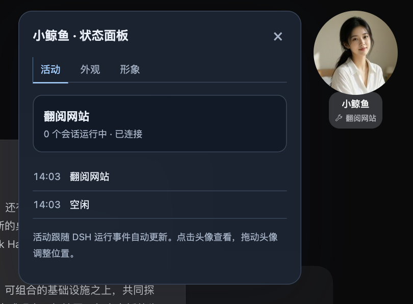
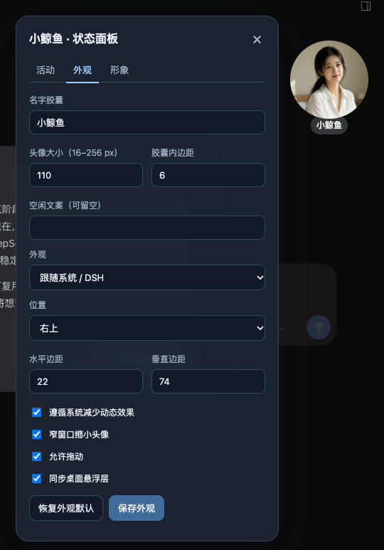

# DSH Activity Avatar

[简体中文](README.md) · [Download v0.2.0](https://github.com/wgytcdx/dsh-typing-buddy/releases/tag/v0.2.0) · [MIT License](LICENSE)

Inspired by the activity avatar in Muse, this floating avatar follows session, tool, and background activity in the DeepSeek Harness web interface. It displays the current status below its name. Click it for recent activity or right-click to open appearance settings.



## Gallery

| Idle | Creating | Waiting | Completed |
| :---: | :---: | :---: | :---: |
|  |  |  |  |

### macOS desktop overlay


The overlay can display the name and activity when the DSH window is hidden. It requires the separate macOS companion.

## Install

Tested with DSH `0.2.1-rc.2`. The package ID is `dsh-typing-buddy`.

- **Desktop** — In Plugins, choose Add Plugin and the GitHub source, then enter `wgytcdx/dsh-typing-buddy`. You can also extract the [prebuilt package](https://github.com/wgytcdx/dsh-typing-buddy/releases/download/v0.2.0/dsh-typing-buddy-0.2.0.tgz) and select the extracted `package` folder as a local directory.
- **Web** — With DSH CLI and Node.js 22, run:

```bash
dsh plugin --profile web add 'github:wgytcdx/dsh-typing-buddy#v0.2.0'
dsh --profile web
```

To remove the plugin, use its Uninstall action in Desktop or run `dsh plugin --profile web remove dsh-typing-buddy` for Web.

## Use

- Click the avatar to open the Activity, Appearance, and Avatar tabs. Drag it to move it.
- Set a custom avatar name and size in Appearance. You can also change caption padding, position, and theme.
- Assign a still image or muted video to each activity state, such as thinking, creating, waiting, or completion. Import an [asset pack](docs/reference.md#资产包) in the Avatar tab, preview it, and confirm activation. If a video cannot play, the avatar shows the image for that state or the main portrait.
- The optional Agnes API is disabled by default. Generation requests send the chosen prompt and reference to Agnes and may incur charges.



See the [configuration reference](docs/reference.md), [test coverage](docs/acceptance.md), or [report an issue](https://github.com/wgytcdx/dsh-typing-buddy/issues).

## License

[MIT](LICENSE).
