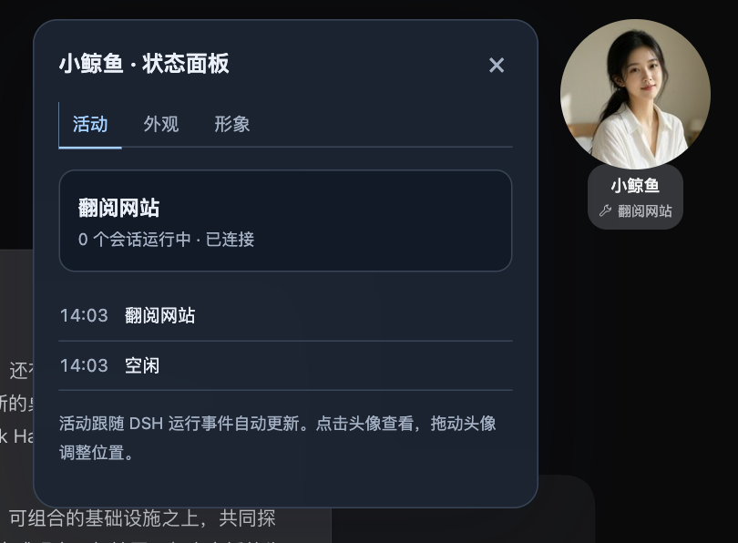
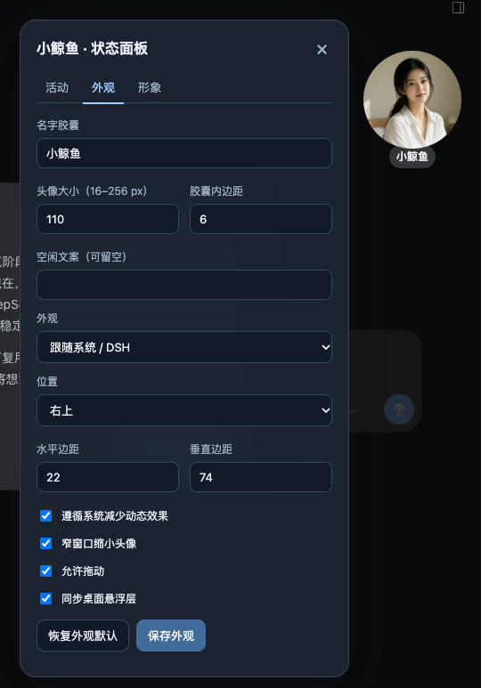

# DSH 活动头像

[English](README.en.md) · [下载 v0.2.0](https://github.com/wgytcdx/dsh-typing-buddy/releases/tag/v0.2.0) · [MIT 许可证](LICENSE)

把当前活动显示在 DeepSeek Harness（DSH）右上角。头像下方独立显示名称和状态。点击头像可看最近活动，右键可调整外观。



## 界面展示

| 空闲 | 正在制作 | 等待结果 | 完成庆祝 |
| :---: | :---: | :---: | :---: |
|  |  |  |  |

### macOS 桌面悬浮窗


DSH 窗口隐藏后，桌面伴侣可以继续显示名称和状态。此效果需要单独运行 macOS 伴侣程序。

## 功能

- **跟随活动**：会话、工具和后台任务进入思考、制作、等待、重连等状态时，头像旁的文案随之更新。
- **外观设置**：自定义名字、头像尺寸、文字框内边距、位置、主题和空闲问候。拖动后会记住位置。
- **形象预览**：导入资产包后先预览，确认激活才替换当前头像。内置静态头像，导入对应视频后可静音播放。
- **活动面板**：查看当前状态和最近活动。窗口隐藏时暂停视频，可跟随系统的减少动态效果设置。

## 安装与更新

已验证 DSH `0.2.1-rc.2`。插件包标识为 `dsh-typing-buddy`，需要带 Web 界面的 DSH。

**桌面版**：打开「插件 → 添加插件」，选择 GitHub 来源，输入 `wgytcdx/dsh-typing-buddy` 并启用。也可下载 [预构建包](https://github.com/wgytcdx/dsh-typing-buddy/releases/download/v0.2.0/dsh-typing-buddy-0.2.0.tgz)，解压后用「本地目录」选择包含 `package.json` 的 `package` 目录。

**Web 版**：在 Node.js 22 环境中，用 DSH CLI 把指定版本加入 `web` profile。

```bash
dsh plugin --profile web add 'github:wgytcdx/dsh-typing-buddy#v0.2.0'
dsh --profile web
```

更新时，在插件管理页使用同一来源切换版本。Web 版可用目标版本的 tag 重跑安装命令。卸载时，在桌面插件详情选择「卸载」，或执行 `dsh plugin --profile web remove dsh-typing-buddy`。

## 使用

| 操作 | 效果 |
| --- | --- |
| 点击头像或名称 | 打开活动、外观和形象面板 |
| 右键头像 | 直接打开外观设置 |
| 拖动头像 | 调整位置 |
| 「形象 → 创建预览候选」 | 读取资产包 JSON 或本机清单，确认后激活 |
| 按 Esc 或点击面板外 | 关闭面板 |



## 数据与网络

活动状态在 DSH 宿主中处理。插件的 HTTP 路由仅允许通过 DSH 认证的所有者访问，配置写入还检查同源。选用在线媒体时，浏览器会请求该媒体地址。

可选的 Agnes 生成 API 默认关闭。启用并发起请求后，会把提示词和选定的参考图发送给 Agnes，可能消耗额度。

## 开发与反馈

- 活动映射、资产包示例、配置和 HTTP 接口见 [配置参考](docs/reference.md)。
- 开发入口为 `src/client.js` 和 `lib/index.js`。修改客户端后运行构建并提交生成的 `lib/client.js`。
- 生成接口见 [Agnes API](docs/agnes-generation.md)，验证范围见 [验收说明](docs/acceptance.md)。
- 问题或建议可在 [GitHub Issues](https://github.com/wgytcdx/dsh-typing-buddy/issues) 提交。

```bash
npm ci
npm run build
npm run check
npm test
npm run test:browser
```

浏览器测试使用 Playwright Chromium 或已安装的 Chrome。需要下载测试浏览器时运行 `npx playwright install chromium`。

## 许可证

本项目采用 [MIT License](LICENSE)。
